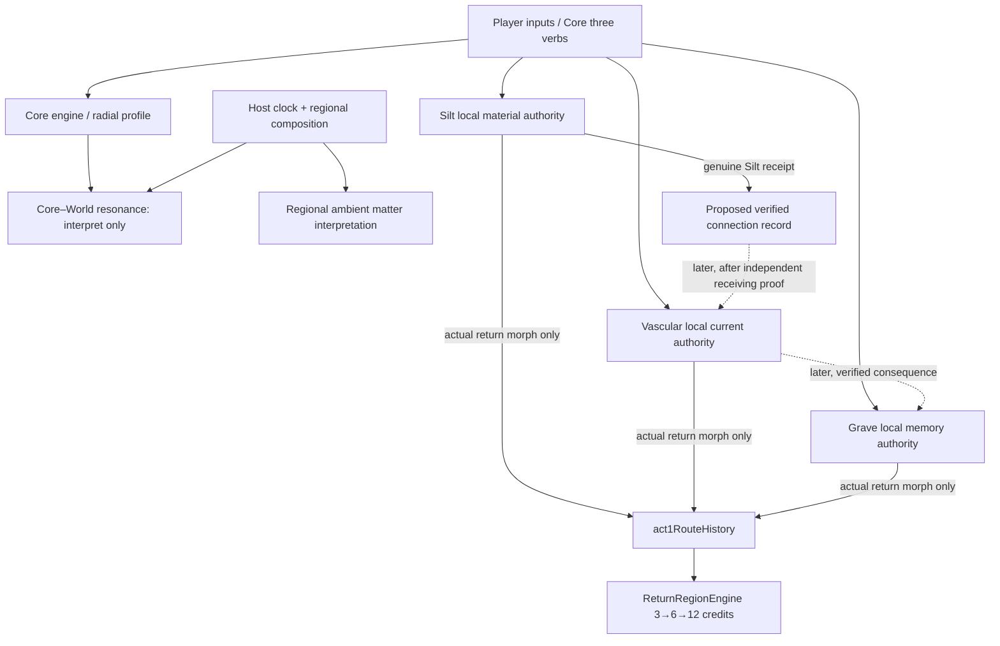

# BLOB: HOST CORE — LS1E0 Host Connection Architecture Audit

**Mode:** Audit only. **Status:** Source ownership mapped; LS1E1 not yet implemented. **Baseline:** LS1A full source with D2N1, D2N1V, D2O1, D2P1 latest route overlays, plus D2J contact and D0 material-identity modules reconstructed for static cross-reference. **No gameplay/source changes in this deliverable.** The source assembly is an audit approximation of the cumulative user's install; no browser run or live repo verification.

## Milestone aim

Connect the HC-era Core/Host/world language to LS1's verified Silt material behavior **without** inventing physical transfer, conflating regional progression with material provenance, or allowing a presentation-only rhythm field to author matter.

> Core acts. World responds. Host governs. Guide interprets.

The three functions are **Pulse, Absorb, Stabilize**. Their world-level regional ordering differs by place; this is a **responsive grammar**, not a required input combination or a new set of verbs. The Core's own fixed firing order is P-A-S; world composition profiles express the three functions in local key/meter.

## Source-grounded findings

1. **Active assembly and lifecycle.** `src/core/GameRuntime.js` constructs and registers the referenced systems. `src/core/SystemRegistry.js` only ticks `runtimeScope: 'active_region'` systems in `firstSliceRuntimeMount.activeSystemIds`. Route objects remain allocated when unmounted, but their `update` does not run. A simulation while hidden **does not exist** just because route state is retained.
2. **The Core's 3→6→12 is real sequencing.** `src/player/CoreEngineSystem.js` represents 3 phases = one per function, 6 = pairs, 12 = four-phase per function, and consumes `returnRegionEngine.unlockedPhaseCount`. It does **not** independently push/absorb/stabilize world material. `CoreVerbEngineCouplingSystem.js` is a presentation interpretation of verbs/engine.
3. **Core anatomy affects existing physiology.** `src/player/CoreRadialPerformanceSystem.js` uses the Deep / Inner / Membrane distribution from `spatialCoreChemistry`, computing reserve, demand, and bounded verb/movement multipliers. Those are real performance data, but no automatic Silt→Vascular→Grave material bridge exists in it.
4. **World composition has a shared clock and real ambient expression, not material-transfer authority.** `WorldCompositionRegistry.js` holds Silt A-S-P (3/4), Vascular P-S-A (4/4), Grave S-A-P (12/8). `HostRhythmSystem.js` publishes the common time/composition. `CoreWorldResonanceSystem.js` publishes alignment/readability only. `RegionalPhysicalEmbodimentSystem.js` computes bounded material-character modifiers consumed by `AmbientMaterialInteractionSystem`; do not accidentally describe this as purely visual, but it is **not** the Silt eight-grain authority and cannot complete a route.
5. **Silt has independent material receipts.** `SiltPressureRouteSystem.js`, `SiltLivingMaterialCycle.js`, `SiltGripAuthority.js`, `MaterialIdentityLedger.js`, `SiltPlateSeat.js`, `SiltTrajectoryMemory.js`, and `SiltTrajectoryFieldProbe.js` jointly govern eight identities, grip/environment owner transfer, native paths, trajectories, placement, and observation. `D2P1` measured all eight IDs visiting Garden, Reservoir, Veins within the Silt route. This is not travel to the separate Vascular or Grave runtime cells. The route expressly pauses free-grain simulation when unmounted.
6. **Vascular already owns a meaningful receive/transmit relationship.** `VascularRhythmRouteSystem.js` uses Stabilize to establish the authored environmental current relationship then Pulse to read/transmit through it. It owns currentization, synchronization/circulation integrity and locally retained return-current consequence. It does not have a receiver for a Silt grain ID.
7. **Grave already owns memory, risk, and consequence.** `GraveMemoryRouteSystem.js` owns read/protect/transfer trace, recoil and imprint; `GraveRuptureHarvestSystem.js` owns its own rupture fragments, and `GraveRuptureConsequenceSystem.js` stores their residue effect for Grave II. Neither currently proves that a specifically identified Silt grain reached Grave.
8. **Existing shared cross-route history must be preserved.** `LocalCellBoundaryMorphSystem.commitHistory()` writes `frameState.act1RouteHistory` from **actual completed region-return morph events**, including Silt, Vascular and Grave completion summaries. `ReturnRegionEngineSystem` consumes that history and separate deduplicated return-region events for 3→6→12 unlocks. `RuntimeStateLedgerSystem` describes who is authoritative; it is not a causal material store. `TemporalHistorySystem` observes time/exposure only. Do not repurpose any of these into invisible physical transportation.
9. **Observation has a bounded-event evidence gap.** D2P1 export dropped the initial period after hitting the recorder's event cap. The 4.8978 reported Absorb-accounting discrepancy is consistent with missing earliest receipts and is **not** proven to be a gameplay pull mismatch. Repair telemetry accounting before accepting an extended cross-region test; use separate cumulative totals from canonical owners, not only retained sample events.

## KEEP / MIGRATE / RETIRE / UNKNOWN ownership table

| Source / existing domain | Status | Actual owner | Integration rule |
|---|---|---|---|
| `GameRuntime`, `SystemRegistry` | KEEP | Tick order, mount lifecycle | Do not create a second update scheduler |
| `CoreEngineSystem` | KEEP | 3→6→12 engine phase | No material teleport/route completion |
| `CoreRadialPerformanceSystem` | KEEP | Anatomy-based bounded physiology | Read its published weights/performance |
| `HostRhythmSystem` + `WorldCompositionRegistry` | KEEP | Shared composition clock & profiles | Never make matching rhythm a required button gate |
| `RegionalPhysicalEmbodimentSystem` + `AmbientMaterialInteractionSystem` | KEEP | Bounded authored ambient matter response | Not owner of eight Silt identities |
| `CoreWorldResonanceSystem`, `CoreVerbEngineCouplingSystem` | KEEP | Interpretation / presentation | Cannot author causal transfer |
| `SiltPressureRouteSystem` + material/grip/seat/trajectory modules | KEEP | Route-local material, receiving plate, movement history | Preserve eight units and one plate occupant |
| `VascularRhythmRouteSystem` | KEEP | Current relationship, circulation integrity | May *consume* a verified connection receipt in later pass |
| `GraveMemoryRouteSystem`, `GraveRupture*` | KEEP | Grave's local read/protect/transfer and rupture residue | Do not forge Silt material into Grave fragments |
| `LocalCellBoundaryMorphSystem` | KEEP | Active-cell transition and route-return history writes | Do not write synthetic route-return flags |
| `ReturnRegionEngineSystem` | KEEP | Deterministic returns and 3→6→12 credit | No free unlocks from integration events |
| `RuntimeStateLedgerSystem` | KEEP | Authority declaration/reporting | Not a new interaction ledger |
| `TemporalHistorySystem` | KEEP | Simulation-time observation | No off-route or offline catch-up |
| Dedicated Host connection receipt ledger | **NEW PROPOSAL for E1** | A small, separate verified interaction-event provenance record | This does not exist yet; no material ownership mutation |
| Cross-region material transporter / off-route physics | **UNKNOWN / NOT BUILT** | Unassigned | Must not be claimed or silently prototyped in E1 |
| Duplicate legacy/overlay deletions | **NONE AUTHORIZED** | Not yet audited exhaustively | Don't delete HC systems by name alone |

## Live contract boundary



**Solid lines:** existing source-grounded ownership or the proposed new receipt input. **Dashed lines:** NOT implemented; future causal integration must earn these connections. A route-local Silt `Garden→Reservoir→Veins` probe is not the same as a `Silt runtime cell→Vascular runtime cell` transfer.

## Proposed minimal interaction receipt contract (E1, not implemented)

Each accepted causality record must carry only grounded facts:

```json
{
  "schemaVersion": 1,
  "id": "monotonic-deduplicated-event-id",
  "kind": "silt_material_disturbance_observed",
  "sourceCellId": "CELL_SILT_PRESSURE_ROUTE_001",
  "sourceSystem": "SiltPressureRouteSystem",
  "subjectId": "silt-grain-01",
  "simulationSeconds": 0,
  "sourceReceiptSequence": 0,
  "effectType": "observed_only",
  "materialTransfer": false,
  "routeCredit": false,
  "targetCellId": null
}
```

This is a **schema proposal, not a sample of actual runtime data**. Event source is the authoritative Silt transaction/trajectory receipt, not an input edge or rendered pulse. Never change `MaterialIdentityLedger.owner` based on an abstract event. A physical receiver later needs its own detected world contact/entry and conservation/reconciliation proof. Repeated events should be idempotent; cap the receipt buffer and maintain cumulative counters separately. Host-level consequences (future) should be bounded, have a cause ID, and survive route revisit in runtime, without inventing offline persistence.

## LS1E1 — Proposed next pass (not in this archive)

**Mode:** Convergence / instrumentation. **Purpose:** Implement a single canonical provenance path from an actual Silt disturbance to a read-only Host connection receipt, and show the receipt when inspecting Vascular **without implying that the grain moved there**.

**Allowed:** One small connection record module; minimal `GameRuntime` registry hook; one Silt authoritative event adapter; a read-only Vascular diagnostic/presentation consumer; capture summary counters and one dedupe test; improve retained-event sampling/accounting for >5-minute sessions.

**Forbidden:** New habitat/receiving socket; unverified cross-cell travel; Grave memory mutation; synthetic Act 1 route completion; chemistry/material count changes; changing Core verbs, pulse force, camera, movement, North Star 0.44/0.74/2.1/1.8 settings, or plate visuals.

**Visual target:** A small, unmistakable 'remote cause received' trace in the already-present Vascular inspection/debug representation, with the correct grain ID, originating Silt cell, and explicit **signal-only** status; no depiction of a physically arrived grain. **Feel target:** Existing Silt interaction unchanged.

**Acceptance:** Silt release produces exactly one deduplicated, durable runtime receipt with a grain ID; idle input, plain Pulse, and an unrelated route do not fabricate receipts; entering Vascular shows the cause ID without consuming/duplicating the grain; returning to Silt still shows eight IDs and original location/trajectory/plate; reloading may reset unless save persistence is separately scoped.

**Regression:** Silt 8/8 mass; no second simultaneous grip; plate stays/reattaches; free grain phase/North Star intact; Vascular currentization progression normal; Grave risk/imprint unchanged; Core architecture unlocks unchanged; no new crossing owner; summary counts reconcile with canonical transaction totals despite buffer rollover. Test Node unit + Vite browser; user validates recorded visibility.

**Delete/disable targets:** none in E1. Inspect overlap after playtest, then explicitly retire only an identified duplicate, never a whole HC legacy family wholesale.

## E2–E4 beyond the first receipt

- **E2 (actual Vascular receiver):** Choose an authored receiving surface and establish a localized, player-verifiable **contact** outcome distinct from the existing Silt plate. Only a real contact receipt earns a Vascular circulation effect; no magical grain migration.
- **E3 (Grave memory):** Let Grave record a *proven consequence* (e.g. changed circulation/read quality) under its own memory rules. Keep Grave rupture fragment ledger separate from Silt grains.
- **E4 (Host feedback):** Return to Silt/Vascular and see a bounded consequence of the same cause; compare three Core topologies and 3/6/12 phase resolution without altering core verb ownership.

## Outstanding proof limits

This audit classified the integration-critical source, **not all 1,600+ historical files**. Relative import completeness alone is not proof of a valid assembled application. No live Vite browser run, networked GitHub sync, or multi-region end-to-end runtime tests were performed. The working Silt trajectory records and test telemetry support route-local retention/cross-habitat movement, not a global material network. Classification of other old HC files remains UNKNOWN pending targeted audit; no deletion is recommended.
