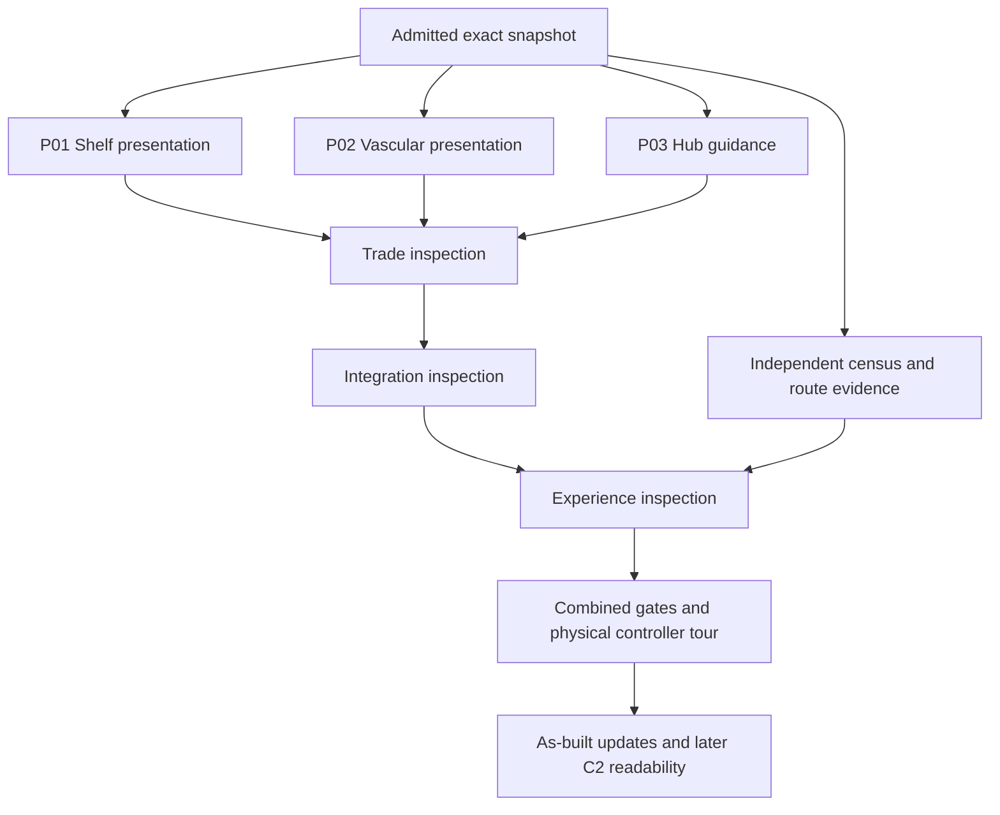

# INTERFACE_AND_DEPENDENCY_REGISTER — WC01 v0.2

| Contract | Owner → consumer | Required interpretation / stop condition |
|---|---|---|
| World identity | Mode and boundary owners → all regional and UI owners | Host, cell, mount and context are authoritative. Retarget or unmount clears transient state. |
| Selection and contact | TargetingSystem → CoreFlowSystem → Shelf receiver → presentation | Keep selected object, intended patch, geometric contact and accepted delivery distinct. Sediment remains the reference. Stop if an independent point or picker appears. |
| Pressure, reserve | Territory receiver → Flow state → CoreRadialPerformanceSystem | Accepted work, resistance and imprint retain host/cell/mount/frame/substep/action/receiver scope. B5-C2 settles once. Stop on rejected or duplicate debit. |
| C2 provenance | Silt grain release → Host ledger → Vascular applied load → Grave recovery witness → B5-B reserve | Preserve parent identities, separate received/accepted/applied, and retain history separately from live response. The material remains in Silt. |
| Traversal | LocalCellBoundaryMorphSystem and native route owners → Hub/UI | Existing permission, approach, return arming and commit remain authoritative. Guidance never grants permission. |
| Ecology | EntitySystem and encounter owners ↔ native local context publications | Being response does not establish material or current ownership. Motion may be environmental, material or a being. No new coupling in WC01. |
| Canon and purple landmark | Source authority, cell/object/mesh capture → World/Lore/Visuals | Full rebuild ZIP unavailable. Landmark color alone cannot resolve its identity. Hold new meaning until verified. |

[Targeting](../../../../src/targeting/TargetingSystem.js) · [Flow](../../../../src/player/CoreFlowSystem.js) · [Receiver](../../../../src/world/RegionalTerritoryExpansion.js) · [Vascular](../../../../src/routes/VascularRhythmRouteSystem.js) · [Hub guidance](../../../../src/hub/HubInvestigationGameplaySystem.js)

## Release dependencies

Read construction disposition by scope from the [Design/RFI Register](DESIGN_RFI_REGISTER.md). For the milestone, S01 and V01 satisfy existing specification boundaries, S02 needs emitter evidence and H01 needs active consumer evidence. Shared changes go through owner and consumer agreement after design approval. Independent verification can be authorized while those gates remain open.
